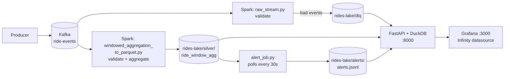

# Realtime Rideshare Pipeline

A streaming pipeline for simulated rideshare events: Kafka → Spark Structured Streaming → Parquet "lake" → DuckDB/FastAPI → Grafana, with dead-letter handling for malformed events and anomaly alerts on ride volume.

## What it does

- A producer emits ride events (`trip_started`, `trip_completed`, `driver_ping`) for five zones at ~5 events/sec, with 5% delivered 30–90 seconds late on purpose.
- Spark validates every event. Bad ones go to a **dead-letter queue (DLQ)**; good ones are aggregated into **5-minute rides-per-zone windows**.
- A detector compares each zone's latest settled window against its previous hour and writes **alerts** for spikes and drops.
- Grafana shows rides, DLQ counts, live anomalies, and alert history.

## Architecture



Both Spark jobs read the same Kafka topic independently. Each has its own checkpoint, so they progress and restart separately.

## Project layout

```
realtime-rideshare-pipeline/
├── infra/
│   ├── docker-compose.yml          Kafka (KRaft, single broker) + Grafana
│   └── grafana/provisioning/
│       ├── datasources/infinity.yml
│       └── dashboards/{dashboards.yml, rides.json}
├── producer/
│   ├── producer.py                      event generator
├── streaming_job/
│   ├── validation.py               shared validation rules
│   ├── raw_stream.py               validates; sole writer of the DLQ
│   └── windowed_aggregation_to_parquet.py
├── dashboards/
│   ├── api.py                      FastAPI endpoints Grafana reads
│   ├── anomaly.py                anomaly detection (SQL over the lake)
│   └── alert_job.py                polls detector, writes alerts.jsonl
└── ~/rides-lake/                   the "data lake" (outside the repo)
    ├── silver/ride_window_agg/window_date=…/window_hour=…/*.parquet
    ├── dlq/            alerts/alerts.jsonl
    └── checkpoints/    _checkpoints/
```

## Running it

Prerequisites: Docker Desktop, Python venv with `pyspark`, `duckdb`, `fastapi`, `uvicorn`, `confluent-kafka`. Tested with Python 3.14 and Spark 4.2.0 (Scala 2.13).

Use one terminal tab per process. Each Python tab needs the venv active (`source venv/bin/activate` from the project root). Commands must be run from the folder shown.

| # | Folder | Command |
|---|---|---|
| 1 | `infra/` | `docker compose up -d` |
| 2 | `streaming_job/` | `spark-submit --packages org.apache.spark:spark-sql-kafka-0-10_2.13:4.2.0 raw_stream.py` |
| 3 | `streaming_job/` | `spark-submit --packages org.apache.spark:spark-sql-kafka-0-10_2.13:4.2.0 windowed_aggregation_to_parquet.py` |
| 4 | `dashboards/` | `uvicorn api:app --host 0.0.0.0 --port 8000` |
| 5 | `producer/` | `python producer.py` |
| 6 | `dashboards/` | `python alert_job.py` |

`--host 0.0.0.0` on the API matters: Grafana runs in Docker and reaches the API at `host.docker.internal:8000`.

Open Grafana at http://localhost:3000 (admin / admin) → **Rideshare Pipeline**. Rides appear after about 6 minutes, because a window must close before it is written. Anomaly panels need roughly 35 minutes of continuous traffic.

**Stop:** Ctrl+C in each tab; `docker compose down` in `infra/` to stop Kafka and Grafana.
**Reset everything:** stop all jobs, then delete the whole `~/rides-lake` folder (data *and* checkpoints together; deleting only one makes jobs think they have processed events they haven't). The jobs rebuild from Kafka on the next run.

### Verifying it works

1. **Dead letters:** `echo "not json" | docker exec -i broker kafka-console-producer --bootstrap-server broker:29092 --topic ride-events` → `unparseable_json` count rises by one in Grafana.
2. **Anomaly end-to-end:** after ~35 minutes of steady traffic, inject 150 extra `trip_completed` events into one zone in a single window. Within ~7–12 minutes the spike appears in the chart, in `/anomalies`, in `alerts.jsonl`, and in the alert tab. (Observed: 245 rides vs. baseline 94.6, z = 12.2, alert ~10 minutes after the window started.)

## Design decisions

Each entry says what was chosen, why, and what was rejected.

### 1. Validation lives in one file (`validation.py`)
Both Spark jobs read Kafka directly, so a filter in only one job would let bad events into the other. A shared function guarantees one definition of "bad". Rules, checked in this order, first match wins: `unparseable_json`, `missing_trip_id`, `missing_zone`, `missing_event_type`, `missing_or_bad_event_time`, `negative_fare`. An event with several problems is recorded under only the first.

`from_json` does **not** return null for garbage input; it returns a struct of null fields, so a null check on the struct never fires and garbage was mislabelled `missing_trip_id`. The first rule therefore uses `try_parse_json(...) IS NULL` on the raw string.

### 2. One owner for the DLQ
Only `raw_stream.py` writes the DLQ. The aggregation job filters bad events out but does not record them. *Rejected:* both jobs writing the DLQ, which duplicates every bad event. *Trade-off:* the DLQ only fills while `raw_stream.py` is running.

### 3. DLQ as a Parquet sink, with the raw payload
Each dead letter keeps the original string, the reason, the Kafka partition/offset, and a timestamp, so events can be inspected and replayed. *Rejected:* a separate Kafka DLQ topic, which would give easier replay but one more thing to run. There is no replay tool yet.

### 4. 5-minute windows, 2-minute watermark, update mode
The watermark (2 min) is longer than the producer's maximum lateness (90 s), so the intentionally late events are folded into their windows rather than dropped. Update mode emits a window each time it changes, so a window can be written several times as late data arrives.

### 5. Append-only Parquet via `foreachBatch`, deduplicated at read time
Each revision of a window is appended as new rows (partitioned by `window_date`, `window_hour`). Readers take `MAX(rides_completed)` per `(window_start, zone)`. This is correct because **counts only grow**. It is *not* correct for averages, see Known Limitations. *Rejected:* updating Parquet in place (not supported), or a table format like Delta/Iceberg (more machinery than this project needs).

### 6. A local folder stands in for object storage
The lake is `~/rides-lake` on local disk, because a corporate network blocked object-storage registries. The partition scheme matches a real lake, so swapping the path for an `s3a://` URI is the intended migration.

### 7. DuckDB behind a small FastAPI service
DuckDB queries the Parquet files directly, with no database to run. Grafana's Infinity plugin calls the API (`/rides_per_zone`, `/rides_over_time`, `/anomalies`, `/alerts`, `/dlq_summary`). *Rejected:* a database sink (extra service) and pointing Grafana at files directly (not supported).

### 8. Anomaly detection: rolling z-score per zone
Each settled window's ride count is compared with the same zone's previous 60 minutes (12 windows, excluding the window itself). Settings in `anomaly.py`:

| Setting | Value | Why |
|---|---|---|
| Baseline | 60 min | Long enough to smooth noise, short enough to track the traffic level |
| Minimum history | 6 windows | Don't score from a tiny baseline |
| Threshold | \|z\| ≥ 3 | Conventional "unusual" cut-off |
| Spread floor | `max(stddev, sqrt(mean))` | Counts are roughly Poisson (spread ≈ √mean); the floor stops a flat baseline from giving infinite z-scores |
| Minimum change | ≥ 3 rides | Ignore tiny swings in quiet zones |

*Rejected:* ML models. With one metric and steady traffic, a z-score is easy to explain and debug. It would not handle daily seasonality; see Next Steps.

### 9. Only score windows that have settled
The newest window is still being revised by late events, so its count is temporarily low and would raise false drops. A window is scored only when `window_start ≤ newest window_start − 7 min` (5-minute window + 2-minute watermark). This is also why alerts arrive about 10 minutes after the event.

### 10. Zero-fill only when the pipeline was demonstrably alive
A zone that goes silent writes *no row*, so a drop to zero would be invisible. The detector therefore treats a missing row as 0 rides, but **only in time slots where at least 2 zones reported**. Without that rule, gaps when the producer was switched off looked like "0 rides everywhere", and every burst of data after a gap looked like a spike (23 false alerts on a replayed sparse dataset; 0 after the fix). Consequence: a *whole-pipeline* outage is not alerted on, because no slot is active. That needs a separate freshness check.

### 11. Alerts as an append-only JSON Lines file
`alert_job.py` polls every 30 seconds and appends new anomalies to `alerts.jsonl`, deduplicated on `(window_start, zone, kind)`. Settled windows never change, so an alert is stable once raised. Restarting the job does not re-alert. *Rejected:* a push/webhook sink, which can be added later; a file is enough to prove the logic.

### 12. Grafana provisioned as code
The datasource (`uid: rides-api`) and dashboard are files mounted into the container, so the stack comes up with the dashboard already built. Dashboards must be provisioned **after** the datasource with the same `uid`, and `dashboards/` and `datasources/` must be siblings under `provisioning/`.

## Known limitations

- **`avg_fare` is not trustworthy across revisions.** `/rides_per_zone` and `/rides_over_time` take `MAX(avg_fare)`, but an average can go down as well as up between revisions. It isn't shown on the dashboard for that reason. Fix: record a batch timestamp when writing, and pick the latest revision per window (`arg_max`).
- **Many small Parquet files.** Every micro-batch writes several tiny files. A compaction job would merge them.
- **Test zones remain in the lake** (`TEST_OK`, `ZONE_X`) until the lake is reset.
- **Validation gaps:** a `trip_completed` event with no fare, or an unknown `event_type`, is not rejected.
- **Hardcoded path** in `windowed_aggregation_to_parquet.py` (`LAKE_PATH`, `CHECKPOINT_PATH`), unlike the other components, which use `LAKE_ROOT`.
- **Alerts are polled**, not pushed, with up to 30 seconds of added latency.
- **Single-broker Kafka and `local[*]` Spark**: no fault tolerance.
- **Grafana time range:** "Total rides per zone" covers all history, not the dashboard range.

## Next steps

- Seasonality-aware baseline (same hour yesterday / last week) for real daily patterns.
- Pipeline-freshness alert (no new windows for N minutes).
- DLQ replay tool and a Kafka DLQ topic.
- Fix `avg_fare` with revision tracking; add a fare dashboard.
- Compaction job; move the lake to S3/MinIO.

## Troubleshooting (problems hit while building this)

| Symptom | Cause |
|---|---|
| `can't open file '.../raw_stream.py'` | Command run from the wrong folder. The path is relative to the terminal's current folder. |
| `IndentationError` in `raw_stream.py` | A code fragment pasted into `main()` with mixed indentation. |
| `no configuration file provided: not found` | `docker compose` run outside `infra/`, where the compose file lives. |
| Dashboard panels all show "No data" | One of the six processes isn't running. It looks identical whether the producer, a Spark job, or the API is down. |
| `Datasource rides-api was not found` | Provisioning folders mis-nested (`dashboards/` inside `datasources/`), or `infinity.yml` missing. |
| Lake not updating though the producer runs | Aggregation job stopped; restart it and it resumes from its checkpoint. |
| `could not convert string to float: '/Users/.../*.parquet'` | An old `alert_job.py` used with a newer `anomaly.py` whose `find_anomalies()` signature differs. Keep the files from one version together. |